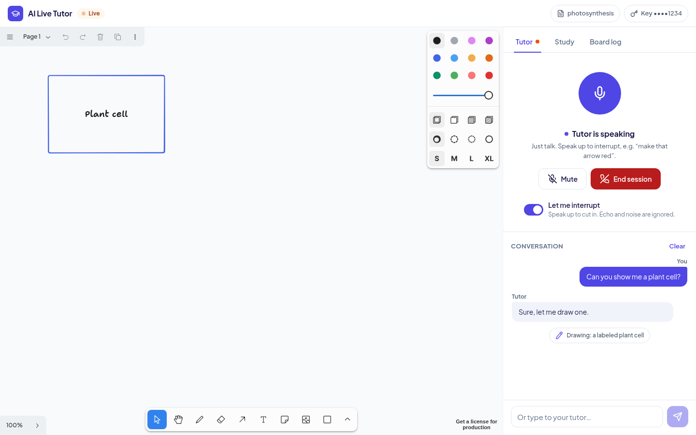
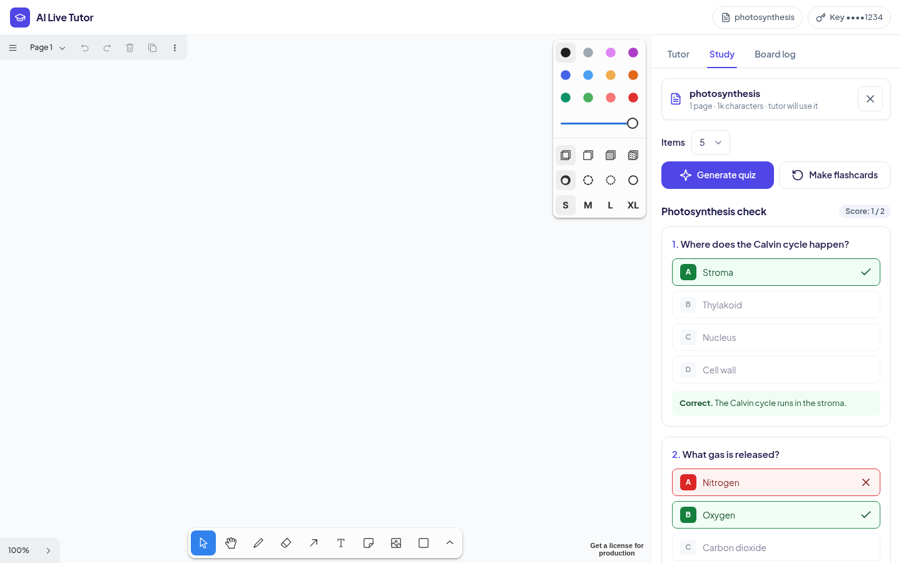
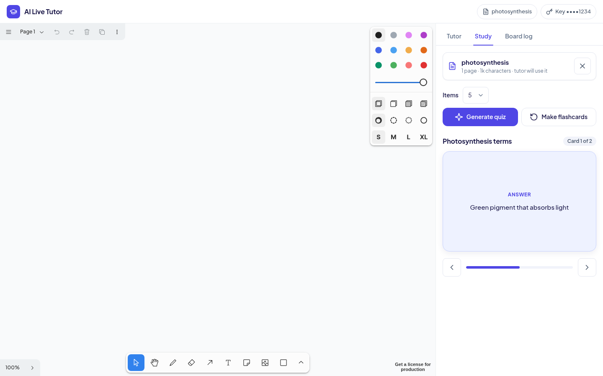
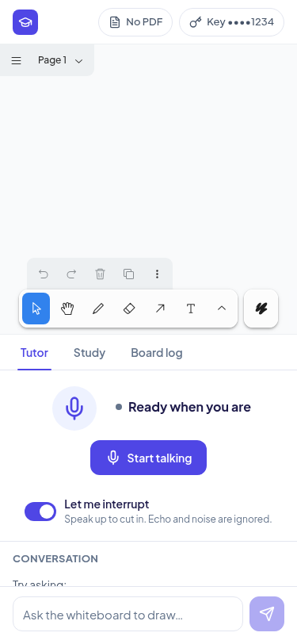
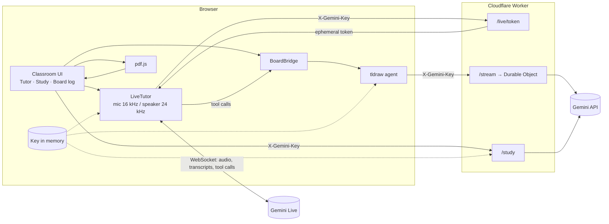

<div align="center">

# AI Live Tutor

**Talk to an AI tutor that explains out loud and draws on a shared whiteboard.**

Real-time voice with Gemini Live · diagrams drawn and edited by an AI agent on a tldraw canvas · quizzes and flashcards from your own PDFs · bring your own Gemini key

[](https://github.com/SohailElskhawy/ai-live-tutor/actions/workflows/ci.yml)
[](LICENSE.md)
[](CONTRIBUTING.md)



</div>

## Why

Studying alone from a PDF is passive. A good tutor talks with you, sketches what they mean, lets you cut in with "wait, why?", and checks that you understood. AI Live Tutor puts that loop in the browser: you speak, the tutor answers by voice and draws on the board as it explains, you interrupt and ask it to change the diagram, then it quizzes you on your own material.

## Features

- **Live voice tutoring.** Built on the Gemini Live API, with transcripts. You can talk over the tutor to interrupt, while echo and background noise are filtered out, or turn interruptions off.
- **Draws while it explains.** The voice model calls whiteboard tools (`draw_on_whiteboard`, `edit_whiteboard`, `look_at_whiteboard`, `stop_drawing`). These drive the tldraw agent, which creates and edits real shapes on the canvas.
- **Edits the existing diagram.** "Make that arrow red" updates the shapes that are already there instead of redrawing from scratch.
- **Your drawings are safe.** Shapes you draw are tagged, and the agent can't delete them.
- **Study from your PDF.** Text is extracted in the browser, so the file is never uploaded. The voice tutor and the drawing agent both use it as context.
- **Quizzes and flashcards.** Multiple-choice quizzes with instant feedback and a score, and flip cards with keyboard navigation, all generated from the PDF.
- **Bring your own key.** Your Gemini key stays in the page's memory only, is sent to the Worker in a header, and is never stored or logged. Voice uses short-lived, single-use tokens.
- **Resilient.** It falls back to other Gemini models when one is overloaded, and shows clear errors for invalid keys, exhausted credits and rate limits.

| Quiz | Flashcards | Mobile |
|---|---|---|
|  |  |  |

> **Demo:** _live link coming soon_ · **Video:** _add your demo video link here_

## Tech stack

| Layer | Technology |
|---|---|
| Frontend | React 19, Vite 8, TypeScript, plain CSS |
| Whiteboard | [tldraw SDK](https://tldraw.dev) and its [agent starter kit](https://tldraw.dev/starter-kits/agent) |
| Voice | [Gemini Live API](https://ai.google.dev/gemini-api/docs/live) via `@google/genai`, with Web Audio and an AudioWorklet |
| AI calls | Vercel AI SDK (`ai`, `@ai-sdk/google`), `zod` schemas |
| Backend | Cloudflare Workers and a Durable Object (`itty-router`) |
| PDF | `pdfjs-dist`, client-side |
| Tests | Playwright |

## Architecture



1. The student enters a Gemini key. It's kept in an in-memory atom, never in storage.
2. **Voice:** the Worker exchanges the key for a single-use ephemeral token. The browser opens the Live WebSocket with that token and streams microphone audio.
3. **Drawing:** when Gemini calls a whiteboard tool, `BoardBridge` calls `agent.interrupt(...)` on the existing tldraw agent. The agent streams actions from `/stream`, and the Worker calls Gemini with the student's key.
4. **Study:** PDF text is extracted locally and sent to `/study`, which returns a typed quiz or flashcard deck.

<details>
<summary>Where things live</summary>

| Area | Files |
|---|---|
| Classroom UI | `client/classroom/*`, `client/App.tsx` |
| Voice | `client/voice/LiveTutor.ts`, `client/voice/audio.ts`, `client/voice/echoGate.ts`, `worker/routes/liveToken.ts` |
| Agent bridge | `client/tutor/boardBridge.ts`, `client/tutor/studentShapes.ts`, `worker/prompt/sections/tutor-section.ts` |
| BYOK and errors | `client/tutor/keyStore.ts`, `worker/byok.ts`, `worker/errors.ts`, `worker/models.ts` |
| Study tools | `client/study/*`, `client/parts/StudyMaterialPartUtil.ts`, `worker/routes/study.ts`, `shared/study.ts` |
| Model names | `shared/live.ts` (voice, study, fallbacks), `shared/models.ts` (drawing agent) |
| Starter kit internals | `client/agent`, `client/actions`, `client/parts`, `worker/do`, `worker/prompt`. See the [tldraw agent docs](https://tldraw.dev/starter-kits/agent). |

</details>

## Quick start

**Prerequisites:** Node.js 22.12+ (or 20.19+), npm, a Chromium-based browser, and a [Gemini API key](https://aistudio.google.com/apikey).

```bash
git clone https://github.com/SohailElskhawy/ai-live-tutor.git
cd ai-live-tutor
npm install
npm run dev
```

Open <http://localhost:5173>, paste your Gemini API key and click **Start learning**.

> Use `localhost` (not a LAN IP): browsers only allow microphone access on `localhost` or HTTPS.

## Usage

1. **Talk:** on the **Tutor** tab, click **Start talking** and allow the microphone. Try *"Teach me the sine function and draw it."*
2. **Interrupt:** while it's explaining, say *"Wait, label the peak at π/2."* The tutor stops and edits the diagram. Turn off **Let me interrupt** if you'd rather it always finished speaking.
3. **Type instead:** use the box at the bottom of the Tutor tab. Without a voice session, typed requests go straight to the whiteboard.
4. **Study:** on the **Study** tab, upload a text-based PDF, then click **Generate quiz** or **Make flashcards**. Start a new voice session and the tutor teaches from the PDF.
5. **Board log:** the **Board log** tab shows every action the drawing agent took.

## Environment variables

Nothing is required for local development: students bring their own key in the UI.

| Variable | Where | Purpose |
|---|---|---|
| `VITE_TLDRAW_LICENSE_KEY` | `.env` (see [`.env.example`](.env.example)) | tldraw SDK license key. **Required in production**, optional on localhost. Get a [hobby license](https://tldraw.dev/get-a-license/hobby) (non-commercial) or a [trial or commercial license](https://tldraw.dev/pricing). The key is public and tied to your domain. |
| `GOOGLE_API_KEY` | `.dev.vars` (see [`.dev.vars.example`](.dev.vars.example)) or `wrangler secret put` | Optional server-side Gemini key. |
| `ALLOW_SERVER_KEY` | same as above | Set to `true` to let requests without a student key use `GOOGLE_API_KEY`. Off by default, because everyone's usage would be billed to you. |

## Scripts

| Command | What it does |
|---|---|
| `npm run dev` | Vite and the Worker locally on <http://localhost:5173> |
| `npm run typecheck` | `tsc --noEmit` |
| `npm run test:e2e` | Playwright end-to-end tests (starts the dev server) |
| `npm run build` | Production build into `dist/` |
| `npm run deploy` | Build and deploy to Cloudflare Workers |

### Tests

The Playwright suite runs the real app and Worker. Gemini is mocked at the network edge (the Live WebSocket, `/stream` and `/study`), so it needs no API key. It covers:

- speaking, drawing, interrupting and editing the diagram
- PDF upload, quizzes and flashcards
- key handling and the guard that keeps student drawings safe
- echo filtering and parsing of the model's replies
- layouts at 1440, 768 and 375 px

A few tests send a deliberately invalid key to Google to check the error messages, so they need network access.

```bash
npx playwright install chromium   # first time, unless you have /usr/bin/chromium
npm run test:e2e
```

To try real Gemini Live from the command line: `GEMINI_API_KEY=... node scripts/check-live.mjs` (with `npm run dev` running).

## Deploy

```bash
npx wrangler login
echo "VITE_TLDRAW_LICENSE_KEY=your_key" > .env   # optional; without it tldraw shows a licensing notice
npm run deploy
```

The app is served at `https://ai-live-tutor.<your-subdomain>.workers.dev`. Students still bring their own Gemini key, so hosting costs you nothing in AI usage.

## Contributing

Contributions are welcome, including during Hacktoberfest. Read [CONTRIBUTING.md](CONTRIBUTING.md) for setup, conventions and the PR process, and the [Code of Conduct](CODE_OF_CONDUCT.md). Good places to start are issues labelled `good first issue` and the roadmap below.

Found a security issue? Please follow [SECURITY.md](SECURITY.md) instead of opening a public issue.

## Roadmap

- [ ] Let the voice tutor *see* the board by sending whiteboard snapshots to Gemini Live
- [ ] Session resumption for voice sessions longer than about 10 minutes
- [ ] Lock the tools and instructions into the ephemeral token (`liveConnectConstraints`)
- [ ] OCR for scanned PDFs
- [ ] Spaced repetition and saved progress for flashcards and quizzes
- [ ] Arabic and Turkish UI and voice prompts
- [ ] Per-student Durable Objects instead of one shared instance
- [ ] Export the whiteboard and transcript as study notes

## Hackathon

Built at **Hacktoberfest Hack Day Istanbul × Hadith Tech 2026**.

## License

The code in this repository is released under the [MIT License](LICENSE.md). It is built on the MIT-licensed tldraw agent starter kit.

The **tldraw SDK** (`tldraw` package) it depends on is *not* MIT. It is covered by the [tldraw SDK license](https://tldraw.dev/legal/tldraw-license), which requires a license key in production and the tldraw watermark to stay visible unless you have a commercial license. Gemini usage is subject to [Google's terms](https://ai.google.dev/gemini-api/terms).
